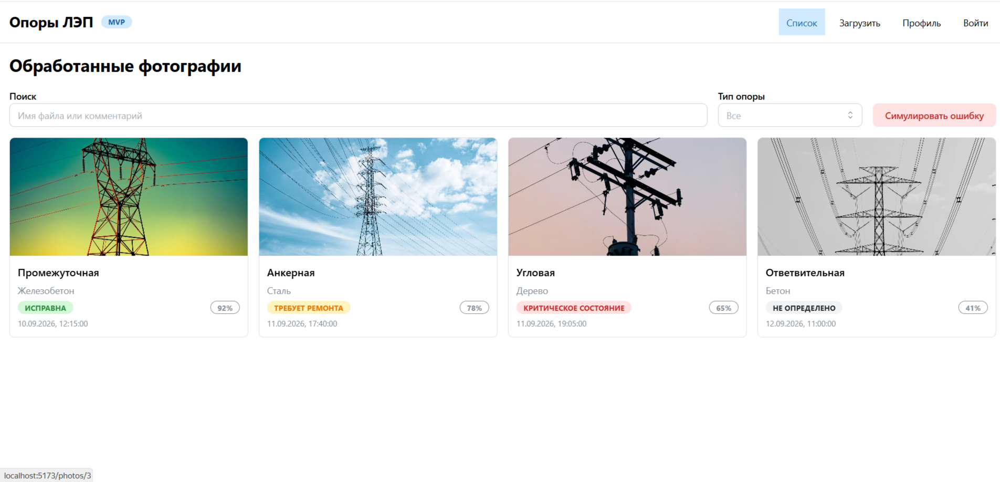
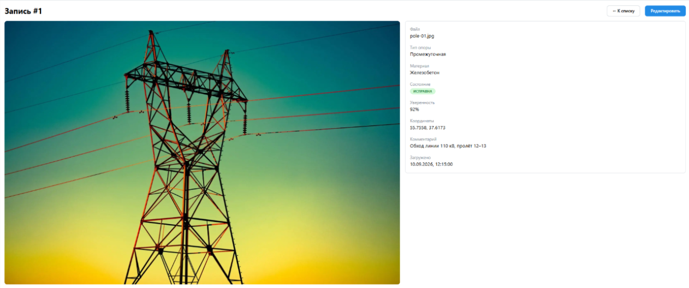
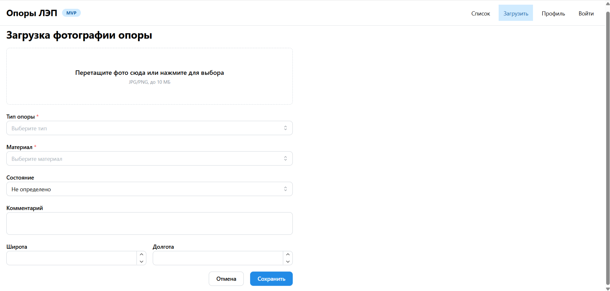
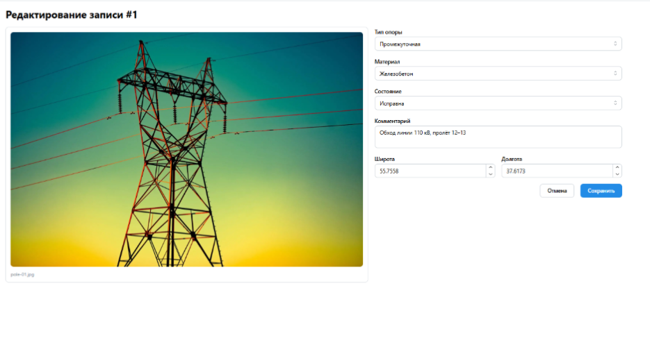
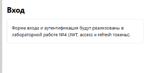
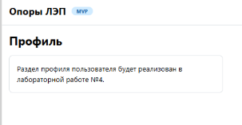
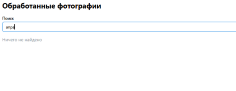
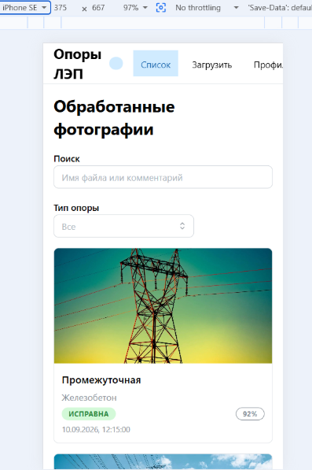

# Обнаружение и классификация опор ЛЭП

Веб-приложение для загрузки фотографий опор линий электропередачи, их классификации по типу, материалу и состоянию, а также ведения истории обработки с поиском и фильтрацией.

В первом семестре реализуется интерфейс и серверная часть MVP. Модель машинного обучения для обнаружения и классификации опор в рамках первого семестра не разрабатывается — на этом этапе классификация представлена демонстрационными данными. Подключение реального алгоритма планируется отдельно.

## Пользовательские сценарии

1. Просмотр списка обработанных фотографий с превью и краткой информацией.
2. Просмотр деталей записи: большое изображение и полный набор атрибутов.
3. Загрузка новой фотографии с указанием типа опоры, материала и состояния.
4. Ручная корректировка классификации, если она определена неверно.
5. Поиск по имени файла и комментарию, фильтрация по типу опоры.
6. Вход в систему и просмотр профиля — разделы появятся в лабораторной работе №4.

## Экраны приложения

| Маршрут | Назначение |
| --- | --- |
| `/` | Список записей |
| `/photos/upload` | Загрузка новой фотографии |
| `/photos/:id` | Детали записи |
| `/photos/:id/edit` | Редактирование классификации |
| `/login` | Вход в систему (заглушка) |
| `/profile` | Профиль пользователя (заглушка) |
| `*` | Страница 404 |

## Модель данных

Основная сущность — запись об обработанной фотографии опоры.

Поля записи:

- `id` — идентификатор
- `imageUrl` — путь к изображению
- `fileName` — исходное имя файла
- `poleType` — тип опоры
- `material` — материал
- `condition` — состояние
- `confidence` — уверенность классификации (0..1)
- `latitude`, `longitude` — координаты (опционально)
- `comment` — комментарий
- `uploadedAt` — дата загрузки
- `uploadedBy` — идентификатор пользователя

Справочные перечисления:

- Тип опоры: анкерная, промежуточная, угловая, транспозиционная, ответвительная
- Материал: дерево, бетон, сталь, железобетон
- Состояние: исправна, требует ремонта, критическое состояние, не определено

Пользователь: `id`, `email`, `name`.

## Стек

- React 18 и TypeScript
- Vite
- React Router
- Mantine (библиотека UI-компонентов)

## Структура проекта

```
src/
├── components/     переиспользуемые компоненты
├── pages/          страницы приложения
├── data/           демонстрационные данные
├── types/          типы предметной области
├── utils/          словари подписей и вспомогательные функции
├── App.tsx         маршрутизация
└── main.tsx        точка входа и провайдеры
```

## Запуск frontend

Требуется Node.js версии 20 или выше.

Установка зависимостей:

```bash
npm install
```

Запуск в режиме разработки:

```bash
npm run dev
```

Приложение откроется по адресу http://localhost:5173.

Сборка production-версии и её предпросмотр:

```bash
npm run build
npm run preview
```

## Скриншоты

Список записей:



Детали записи:



Загрузка фотографии:



Редактирование классификации:



Страница входа:



Профиль пользователя:



Страница 404:



Мобильная версия списка:


---

Учебный проект. Первый семестр курса «Fullstack».